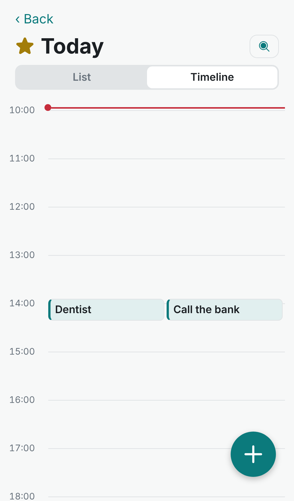

# MyThings

A personal To-do app for one person, built with React Native and Expo, that keeps everything on your device and works offline.

<p>
  
  
  
  
</p>

## What works today

Milestones 1 (core) and 2 (planning) are done. Words in capitals are defined in [`GLOSSARY.md`](GLOSSARY.md).

**Organising (Milestone 1)**

- **To-dos** with notes (Markdown), a Checklist, Sub-to-dos (one level deep) and Tags.
- **Areas** and **Projects**, with **Headings** inside Projects and a progress pie on each Project.
- **Built-in lists**: Inbox, Today (with This Evening), Upcoming, Anytime, Someday, Logbook and Trash.
- **Start date** (shown as "When") and **Deadline**; Completed and Cancelled outcomes. Finished To-dos move to the Logbook at the end of the day, straight away, or by hand (Settings). Trash empties itself after 30 days.
- **Magic Plus** to add a To-do anywhere, **swipe actions**, **multi-select** for bulk changes, and **dragging** to reorder or drop on a list.
- **Quick Find** across To-do titles, notes and Checklist items, and the names of Areas, Projects, Headings and Tags.

**Planning (Milestone 2)**

- **Priority** (low, medium, high), **Energy** (low, high) and **Estimate** in minutes. Today's header shows the total Estimate.
- **Time slots**: a start and end time on the Start date. Today switches between List and a **timeline** of the day, with overlapping slots side by side.
- **Repeat rules**, on schedule or after completion. Schedules go as far as "the last weekday of the month" or "the 2nd Tuesday of March", and a rule can end never, after N occurrences, or on a date. Upcoming shows **projected dates** as dashed rows. Editing a repeating To-do asks "this one or all future ones".
- **Smart Lists** in the sidebar: saved filters on Tags, Areas, Projects, Start date, Deadline, Priority, Energy and Estimate. Different kinds combine with AND, values of one kind with OR.
- **Quick entry shorthand**: `Buy milk tomorrow #errand !high ~15m @14:00` adds "Buy milk" for tomorrow, tagged errand, high Priority, a 15-minute Estimate and a 14:00 Time slot. Dates also read as `today`, `fri`, `next fri`, `on 12 Dec`, `in 3 days`, `tonight` and `someday`.

**Look and feel**

- **Phosphor icons** with a colour per list. Light and dark mode follow the system; six accent colours, teal by default.
- **iPhone web-app fixes**: the keyboard no longer covers the new To-do field, no white shows behind sheets, and the status bar blends into the app instead of a white band.

**Not yet**

- Sign-in, sync, attachments, export and backup (Milestone 3, in progress). The Supabase project exists, but until Milestone 3 lands **your data lives in one place**: one phone, or one browser.
- Reminders, notifications and calendar (Milestone 4); share sheet, Place Reminders, widgets, Siri, Watch and email-to-Inbox (Milestone 5, switched off, see [ADR 0003](docs/adr/0003-features-gated-without-apple-developer-account.md)).
- The app has been used on an iPhone as a Home Screen web app, but **not yet in Expo Go** or on Android.

## Use it on your iPhone (no laptop)

The app runs as a web app saved to your Home Screen. It is published with GitHub Pages at <https://peucmccann.github.io/My-Things-1/>. GitHub only hosts the app's code; your To-dos are stored in the browser on your phone.

**Install it:**

1. Open <https://peucmccann.github.io/My-Things-1/> in Safari.
2. Tap **Share** → **Add to Home Screen** → **Add**.
3. Open MyThings from the Home Screen. It runs full screen, like an app, and picks up a newly published version when it starts (swipe it away in the app switcher if it doesn't).

**Publishing.** [`pages.yml`](.github/workflows/pages.yml) publishes on every push to `main`. To run it by hand: **Actions** → **Deploy web app** → **Run workflow**. A green tick means it's live.

**Good to know:**

- **Data is per browser.** The Home Screen app and a Safari tab keep separate data, so use the Home Screen app. Clearing Safari's website data deletes your To-dos, and there is no export until Milestone 3.
- **Another host.** Any static host works too, such as Netlify or Cloudflare Pages: build with `npx expo export --platform web` and serve `dist`.

## Run it with a computer

Needs Node.js 22.

```bash
npm ci
npx expo start
```

Then scan the QR code with the camera to open it in [Expo Go](https://expo.dev/go) (phone and computer on the same Wi-Fi), or press `w` to open the web version.

## Development

| Command                       | What it does                                                                          |
| ----------------------------- | ------------------------------------------------------------------------------------- |
| `npm test`                    | Vitest: core tests, plus pure helpers in `src/app`                                    |
| `npm run lint`                | ESLint                                                                                |
| `npm run typecheck`           | `tsc --noEmit`                                                                        |
| `npm run format`              | Prettier                                                                              |
| `npm run test:ui`             | Playwright UI checks on the web build at iPhone size (`UI_PORT=8090` for a free port) |
| `npm run check:expo`          | Expo-pinned packages match the SDK's versions                                         |
| `npx expo start`              | Dev server (Expo Go on the phone, or `w` for web)                                     |
| `node scripts/make-icons.mjs` | Redraws the app icons, splash and Home Screen icons                                   |

**Checks.** The pre-commit hook runs ESLint and Prettier on staged files, the Expo version check, the typecheck and the tests. CI ([`ci.yml`](.github/workflows/ci.yml)) runs the same on every push, plus Prettier across all files, the web build and the UI checks. ESLint also enforces:

- `src/core/` imports no React, React Native or Expo, and uses glossary words: no `task`, `label`, `dueDate` or `item` in identifiers (Checklist item is fine).
- Core tests import only the core's actions, queries and types, never internal modules.
- App text says To-do and Tag, not "task", "item" or "label", and uses the Icon component, not emoji.
- Gestures use react-native-gesture-handler, not `PanResponder` ([ADR 0004](docs/adr/0004-gestures-with-react-native-gesture-handler.md)).

**Code layout.**

- `src/core/` holds every rule from [`docs/plan.md`](docs/plan.md), as actions and list queries. The clock and storage are passed in.
- `src/app/` is the React Native UI. It saves the whole store as one JSON snapshot in AsyncStorage (the file system in Expo Go, `localStorage` on the web).
- `e2e/` holds the Playwright UI checks; `scripts/` holds small Node helpers.
- `public/index.html` is the web page template (Home Screen meta tags, icons, status bar and background colours). `app.config.js` sets Expo's `experiments.baseUrl` from `EXPO_BASE_URL`, so only the Pages build is served from `/My-Things-1/`.

**Testing.** Core tests sit next to the code as `*.test.ts`. The UI checks run against the exported web build in Chromium at iPhone 13 size. `SCREENSHOTS=1 npm run test:ui -- screenshots dayTimeline` refreshes `docs/screenshots/`.

**Expo.** The project is on Expo SDK 58; check the [versioned docs](https://docs.expo.dev/versions/v58.0.0/) before using an Expo API. Add packages with `npx expo install <package>`. Only modules bundled in Expo Go can be used, and `ios/` and `android/` are never edited by hand ([ADR 0003](docs/adr/0003-features-gated-without-apple-developer-account.md)).

**Playwright pin.** `@playwright/test` is pinned to the exact version whose Chromium is preinstalled in cloud sessions (`/opt/pw-browsers`), where Playwright cannot download a browser. Keep that pin when upgrading; elsewhere run `npx playwright install chromium` once.

**Working with agents.** The full rules are in [`CLAUDE.md`](CLAUDE.md); in short:

- Read a file before editing it, and re-read it after committing, because the hook rewrites staged files with Prettier.
- One git command per shell call; write commit messages to a file and commit with `git commit -F <file>`.
- Never skip tests or bypass hooks.
- A coordinator hands each ticket to an implementer with [`docs/agents/implementer-brief.md`](docs/agents/implementer-brief.md), one worktree and `UI_PORT` per ticket.

## Project docs

| Where                                                                     | What it's for                                                                              |
| ------------------------------------------------------------------------- | ------------------------------------------------------------------------------------------ |
| [`docs/plan.md`](docs/plan.md)                                            | The design: platform, behaviour rules and milestones.                                      |
| [`GLOSSARY.md`](GLOSSARY.md)                                              | The words the app and code use, and the ones to avoid.                                     |
| [`docs/adr/`](docs/adr/)                                                  | Hard-to-reverse decisions: Expo, local-first sync, features gated without Apple, gestures. |
| [`CLAUDE.md`](CLAUDE.md)                                                  | Instructions for coding agents.                                                            |
| [`docs/agents/`](docs/agents/)                                            | How agents use the issue tracker (GitHub Issues), triage labels and domain docs.           |
| [`docs/agents/implementer-brief.md`](docs/agents/implementer-brief.md)    | The brief a coordinator fills in for each ticket it hands to an implementer.               |
| [`docs/wiki/`](docs/wiki/index.md)                                        | A dated record of decisions, runs and problems. History, not current truth.                |
| [`docs/wiki/retros/`](docs/wiki/retros/)                                  | Retros on the Milestone 1 and 2 build sessions.                                            |
| [`docs/screenshots/`](docs/screenshots/)                                  | Screens at iPhone size, light and dark, per milestone.                                     |
| [`.claude/skills/chief-of-staff`](.claude/skills/chief-of-staff/SKILL.md) | The skill that delegates work to subagents and keeps the wiki.                             |

## Roadmap

| Milestone                                                                                                | Status                                                      |
| -------------------------------------------------------------------------------------------------------- | ----------------------------------------------------------- |
| 1. Core, offline, single device                                                                          | Done (PR #20)                                               |
| 2. Planning: Repeat rules, Priority, Energy, Estimate, Time slots, Smart Lists, quick entry              | Done (PRs #36, #37, #38; tickets #22–#32)                   |
| 3. Sync: sign-in, Supabase sync, attachments, export and backup                                          | In progress: Supabase project `mionebydpkthdqxljrow` set up |
| 4. Phone integrations: Reminders and notifications, calendar events, Apple Reminders import              | Not started                                                 |
| 5. Share sheet, Place Reminders, widgets, Siri, Watch, email-to-Inbox (needs an Apple Developer account) | Switched off                                                |

The full spec is issue #2.
