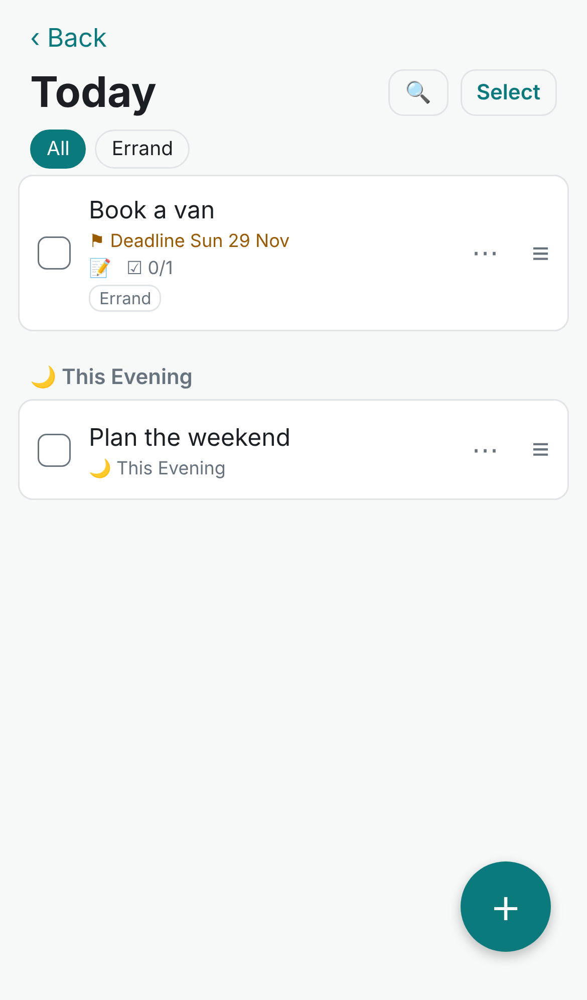
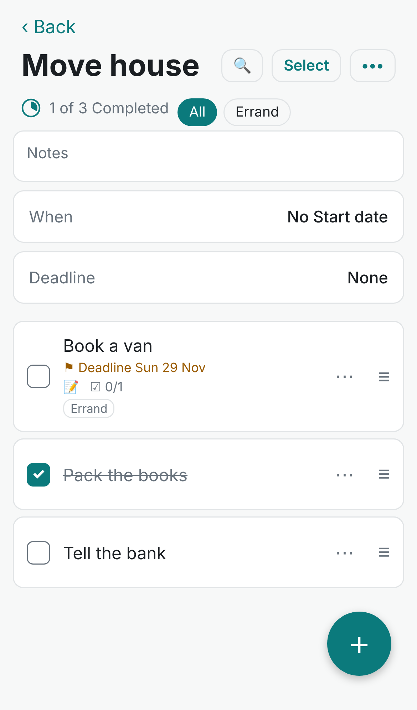
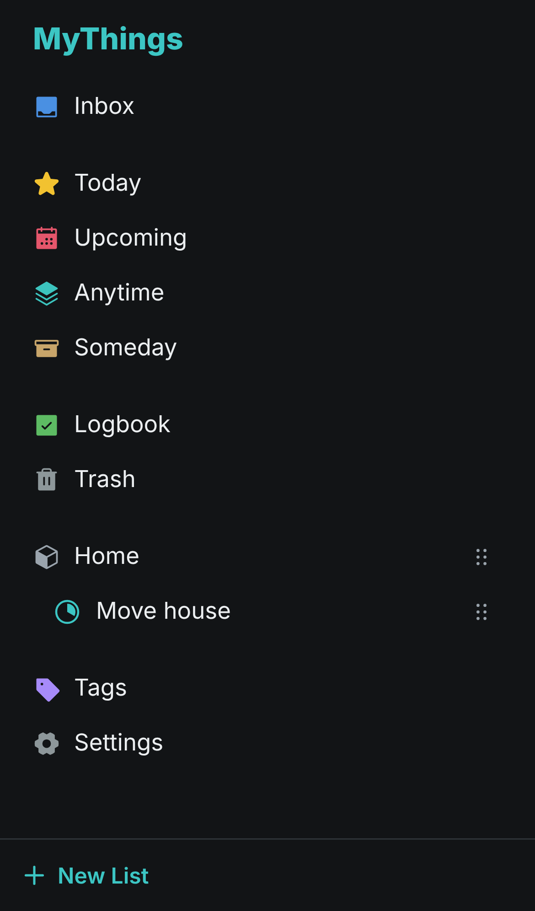

# MyThings

A personal To-do app for one person, built with React Native and Expo, that keeps everything on your device and works offline.

<p>
  
  
  
</p>

## What works today

Milestone 1 (core, offline, single device) is done. Words in capitals are defined in [`GLOSSARY.md`](GLOSSARY.md).

- **To-dos** with notes (Markdown), a Checklist, Sub-to-dos (one level deep) and Tags.
- **Areas** and **Projects**, with **Headings** inside Projects and a progress pie on each Project.
- **Built-in lists**: Inbox, Today (with This Evening), Upcoming, Anytime, Someday, Logbook and Trash.
- **Start date** (shown as "When") and **Deadline**; Completed and Cancelled outcomes. Things you finish move to the Logbook at the end of the day, straight away, or by hand (Settings). Trash empties itself after 30 days.
- **Magic Plus** to add a To-do anywhere, **swipe actions** (right for When, left to select), **multi-select** for bulk changes, and **dragging** with the ≡ handle to reorder or drop on a list.
- **Quick Find** across To-do titles, notes and Checklist items, and the names of Areas, Projects, Headings and Tags.
- Light and dark mode follow the system; six accent colours, teal by default.

Not yet:

- Repeat rules, Priority, Energy, Estimate, Time slots, Smart Lists and quick entry shorthand (Milestone 2).
- Sign-in, sync, attachments, export and backup (Milestone 3). Until then **your data lives in one place**: one phone, or one browser.
- Reminders, notifications and calendar (Milestone 4); share sheet, Place Reminders, widgets, Siri and Watch (Milestone 5, switched off for now, see [ADR 0003](docs/adr/0003-features-gated-without-apple-developer-account.md)).
- Milestone 1 was checked in a headless browser at iPhone size. It has **not been tried in Expo Go on a real phone** yet, nor on Android.

## Use it on your iPhone (no laptop)

The app runs as a web app saved to your Home Screen. It has no server: GitHub only hosts the app's code, and your To-dos are stored in the browser on your phone.

**One-time setup** (in Safari, at github.com; the GitHub app doesn't show repository settings):

1. Open the repository → **Settings** → **Pages**.
2. Under **Build and deployment**, set **Source** to **GitHub Actions**.

**Publish the app.** This happens on every push to `main`. To run it by hand: **Actions** → **Deploy web app** → **Run workflow**. It takes a few minutes; a green tick means it's live.

**Install it:**

1. Open <https://peucmccann.github.io/My-Things-1/> in Safari.
2. Tap **Share** → **Add to Home Screen** → **Add**.
3. Open MyThings from the Home Screen. It runs full screen, like an app, and picks up a newly published version when it starts (swipe it away in the app switcher if it doesn't).

**Good to know:**

- **GitHub plan.** Pages for a private repository needs a paid plan (Pro or Team). The site is public even though the repository is private. It only serves the app's code; your data never leaves your phone.
- **Data is per browser.** The Home Screen app and a Safari tab keep separate data, so pick one (the Home Screen app). Clearing Safari's website data deletes your To-dos, and there is no export until Milestone 3.
- **If Pages isn't available on your plan**, connect the repository to [Netlify](https://www.netlify.com) or [Cloudflare Pages](https://pages.cloudflare.com) from your phone's browser (both free). Use build command `npx expo export --platform web` and output directory `dist`. Those sites serve at the root, so no other settings are needed.

## Run it with a computer

Needs Node.js 22.

```bash
npm ci
npx expo start
```

Then scan the QR code with the camera to open it in [Expo Go](https://expo.dev/go) (phone and computer on the same Wi-Fi), or press `w` to open the web version.

## Development

| Command                       | What it does                                         |
| ----------------------------- | ---------------------------------------------------- |
| `npm test`                    | Core tests (Vitest)                                  |
| `npm run lint`                | ESLint                                               |
| `npm run typecheck`           | `tsc --noEmit`                                       |
| `npm run format`              | Prettier                                             |
| `npm run test:ui`             | Playwright UI checks on the web build at iPhone size |
| `npm run check:expo`          | Expo-pinned packages match the SDK's versions        |
| `npx expo start`              | Dev server (Expo Go on the phone, or `w` for web)    |
| `node scripts/make-icons.mjs` | Redraws the app icons, splash and Home Screen icons  |

**Checks.** The pre-commit hook runs ESLint and Prettier on staged files, the Expo version check, the typecheck and the tests. CI ([`ci.yml`](.github/workflows/ci.yml)) runs all of that on every push, plus Prettier across all files, the web build and the UI checks. [`pages.yml`](.github/workflows/pages.yml) publishes the web app.

**Code layout.**

- `src/core/` holds every rule from [`docs/plan.md`](docs/plan.md), as actions and list queries. It must not import React, React Native or Expo (ESLint enforces this); the clock and storage are passed in. Names follow the glossary, and ESLint rejects avoided words such as `task`, `label` and `dueDate`.
- `src/app/` is the React Native UI. It saves the whole store as one JSON snapshot in AsyncStorage (the file system in Expo Go, `localStorage` on the web). ESLint rejects "task", "label" and "item" in text people read.
- `e2e/` holds the Playwright UI checks; `scripts/` holds small Node helpers.
- `public/index.html` is the web page template (Home Screen meta tags and icons). `app.config.js` sets Expo's `experiments.baseUrl` from `EXPO_BASE_URL`, so only the Pages build is served from `/My-Things-1/`.

**Testing.** Core tests sit next to the code as `*.test.ts` and go through actions and queries only, never internal records. The UI checks run against the exported web build in Chromium at iPhone 13 size. `SCREENSHOTS=1 npm run test:ui -- screenshots` refreshes `docs/screenshots/`.

**Expo.** The project is on Expo SDK 58; check the [versioned docs](https://docs.expo.dev/versions/v58.0.0/) before using an Expo API. Add packages with `npx expo install <package>`. Only modules bundled in Expo Go can be used, and `ios/` and `android/` are never edited by hand ([ADR 0003](docs/adr/0003-features-gated-without-apple-developer-account.md)).

**Playwright pin.** `@playwright/test` is pinned to the exact version whose Chromium is preinstalled in cloud sessions (`/opt/pw-browsers`), where Playwright cannot download a browser. Keep that pin when upgrading; elsewhere run `npx playwright install chromium` once.

## Project docs

| Where                                    | What it's for                                                                       |
| ---------------------------------------- | ----------------------------------------------------------------------------------- |
| [`docs/plan.md`](docs/plan.md)           | The design: platform, behaviour rules and milestones.                               |
| [`GLOSSARY.md`](GLOSSARY.md)             | The words the app and code use, and the ones to avoid.                              |
| [`docs/adr/`](docs/adr/)                 | Hard-to-reverse decisions: Expo, local-first sync, features gated without Apple.    |
| [`CLAUDE.md`](CLAUDE.md)                 | Instructions for coding agents.                                                     |
| [`docs/agents/`](docs/agents/)           | How agents use the issue tracker (GitHub Issues), triage labels and domain docs.    |
| [`docs/wiki/`](docs/wiki/index.md)       | A dated record of decisions, runs, problems and retros. History, not current truth. |
| [`docs/screenshots/`](docs/screenshots/) | Screens at iPhone size, light and dark, per milestone.                              |

## Roadmap

| Milestone                                                                                                | Status                  |
| -------------------------------------------------------------------------------------------------------- | ----------------------- |
| 1. Core, offline, single device                                                                          | Done (merged in PR #20) |
| 2. Planning: Repeat rules, Priority, Energy, Estimate, Time slots, Smart Lists, quick entry              | Not started             |
| 3. Sync: sign-in, Supabase sync, attachments, export and backup                                          | Not started             |
| 4. Phone integrations: Reminders and notifications, calendar events, Apple Reminders import              | Not started             |
| 5. Share sheet, Place Reminders, widgets, Siri, Watch, email-to-Inbox (needs an Apple Developer account) | Switched off            |

The full spec is issue #2.
